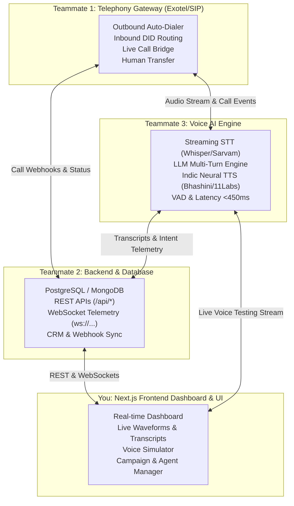

# 🌐 Team Integration Architecture & Real-Time Data Contract

This guide defines the exact API contracts, WebSocket payloads, and integration responsibilities for the **4-person team** building the AI Voice Telephony Platform.

---

## 👥 Team Responsibilities Overview



---

## 📞 1. Teammate 1: Telephony & Call Handling (Exotel Integration)

### Endpoints Required by Frontend:

#### `POST /api/telephony/outbound-call`
Dispatches a single or list-based outbound call via Exotel.
* **Request Payload:**
```json
{
  "toNumber": "+919876543210",
  "recipientName": "Rahul Verma",
  "agentId": "admissions-copilot",
  "language": "hi-IN",
  "customContext": {
    "boardPercentage": "94%",
    "inquiredCourse": "B.Tech CSE"
  }
}
```
* **Response Payload:**
```json
{
  "success": true,
  "callSid": "exo_call_98471209348",
  "status": "initiated"
}
```

#### `POST /api/telephony/control`
Executes in-call actions (e.g. human counselor transfer, hangup, supervisor whisper).
* **Request Payload:**
```json
{
  "callId": "CALL-8921",
  "action": "transfer",
  "transferToNumber": "+919445190871",
  "whisperMessage": "Counselor joining line now"
}
```

#### Exotel Webhook Receivers on Backend:
* `POST /api/telephony/webhook/inbound` (When student/customer dials college number)
* `POST /api/telephony/webhook/status` (Updates call state: `ringing`, `in-progress`, `completed`, `busy`)
* `POST /api/telephony/webhook/recording` (Receives Exotel MP3 recording URL when call concludes)

---

## 🗄️ 2. Teammate 2: Backend API & Real-Time WebSockets

### A. Environment Config (`.env.local`)
```env
NEXT_PUBLIC_API_BASE_URL=http://localhost:8000/api
NEXT_PUBLIC_WS_URL=ws://localhost:8000/ws/telemetry
NEXT_PUBLIC_VOICE_ENGINE_URL=ws://localhost:8080/voice-stream
NEXT_PUBLIC_USE_MOCK_FALLBACK=true
```

### B. Core REST Endpoints

| Method | Endpoint | Description |
| :--- | :--- | :--- |
| `GET` | `/api/calls/history?page=1&limit=20` | Paginated call records, transcripts, and sentiment |
| `GET` | `/api/calls/live` | Currently active connected calls |
| `GET` | `/api/agents` | All configured voice agent personas |
| `PATCH` | `/api/agents/:id/status` | Toggle agent (`active`, `paused`, `training`) |
| `GET` | `/api/campaigns` | List of outbound campaigns & progress percentages |
| `POST` | `/api/campaigns` | Create & trigger outbound campaign with contact list |
| `GET` | `/api/knowledge/documents` | List of RAG documents and vector chunk counts |
| `POST` | `/api/knowledge/upload` | Upload PDF/Doc for vector embeddings |

### C. Real-Time Telemetry WebSocket Protocol (`ws://localhost:8000/ws/telemetry`)
The frontend subscribes to live events via `useLiveTelemetryWs()`. The backend should broadcast these event types:

#### 1. When a new call starts:
```json
{
  "type": "CALL_STARTED",
  "payload": {
    "id": "CALL-9001",
    "callerNumber": "+91 98401 22340",
    "callerName": "Priya Sharma",
    "agentId": "admissions-copilot",
    "agentName": "Maya",
    "direction": "inbound",
    "durationSeconds": 0,
    "currentSentiment": "positive",
    "intent": "Scholarship Eligibility",
    "latestSnippet": "Call connected...",
    "audioWaveLevels": [12, 18, 45, 60, 20],
    "startedAt": "2026-10-10T12:00:00Z",
    "latencyMs": 390,
    "transcript": []
  }
}
```

#### 2. Streaming live speech transcripts:
```json
{
  "type": "TRANSCRIPT_CHUNK",
  "payload": {
    "callId": "CALL-9001",
    "speaker": "agent",
    "text": "For 94% board score, you are eligible for a 35% merit scholarship.",
    "time": "00:14"
  }
}
```

#### 3. Real-time audio waveform energy:
```json
{
  "type": "AUDIO_WAVE_UPDATE",
  "payload": {
    "callId": "CALL-9001",
    "audioWaveLevels": [24, 65, 88, 42, 19, 56, 92, 34]
  }
}
```

#### 4. When call finishes:
```json
{
  "type": "CALL_ENDED",
  "payload": {
    "id": "CALL-9001",
    "contactNumber": "+91 98401 22340",
    "contactName": "Priya Sharma",
    "agentName": "Maya",
    "direction": "inbound",
    "duration": "2m 45s",
    "durationSeconds": 165,
    "outcome": "Interested",
    "timestamp": "2026-10-10T12:02:45Z",
    "summary": "Verified scholarship eligibility and booked campus visit.",
    "sentimentScore": 94,
    "qualification": "High Intent",
    "audioRecordingUrl": "https://s3.telephony.provider/recordings/CALL-9001.mp3"
  }
}
```

---

## 🎙️ 3. Teammate 3: Voice AI Engine (STT / LLM / TTS)

### Live Stream WebSocket (`ws://localhost:8080/voice-stream?persona=maya`)
Used for in-browser testing via `LiveVoiceSimulatorModal.tsx` & `useVoiceEngineTest()`:
* **Client -> Engine:** Sends 16kHz binary WebM/PCM audio chunks from the user microphone.
* **Engine -> Client:**
  1. Sends JSON `{ "type": "transcript", "speaker": "user"|"agent", "text": "...", "latencyMs": 380 }`
  2. Streams binary MP3/PCM audio buffers of synthesized speech to be played immediately in the browser.

---

## 🛠️ 4. How Frontend Code Connects to These Services

All API and WebSocket clients are already prepared with type safety and fallback modes:

```typescript
// 1. Calling Backend REST APIs
import { callsApi, telephonyApi, campaignsApi, knowledgeApi } from "@/lib/api";

// Example: Triggering a call
const response = await telephonyApi.initiateCall({
  toNumber: "+919876543210",
  agentId: "admissions-copilot",
});

// 2. Subscribing to Live Call Telemetry & Transcripts
import { useLiveTelemetryWs } from "@/lib/hooks/useLiveTelemetryWs";

function LiveCallsMonitor() {
  const { liveCalls, isConnected, activeCallCount } = useLiveTelemetryWs();
  // Automatically renders real-time audio waves and streaming text
}

// 3. Testing Voice AI Pipeline from the Browser
import { useVoiceEngineTest } from "@/lib/hooks/useVoiceEngineTest";

function Simulator() {
  const { startVoiceSession, stopVoiceSession, isStreaming, transcript } = useVoiceEngineTest();
  // Handles microphone audio streaming to Teammate 3's engine
}
```
