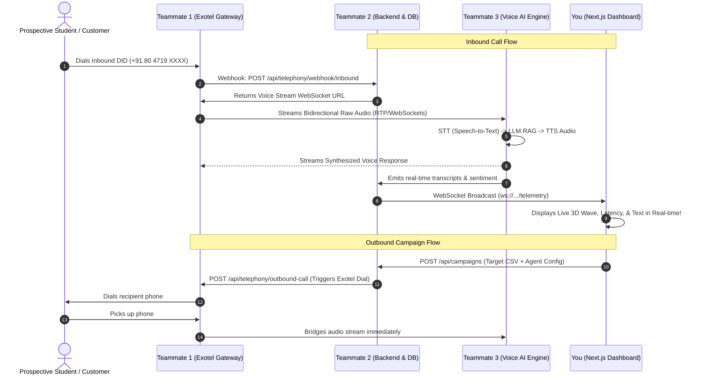

# 🚀 Master Team Integration & Execution Specification

> **Platform:** EduVoice / Aeline Autonomous AI Voice Telephony  
> **Team Structure:** 4 Developers  
> **Frontend Lead:** You (Next.js 16 + React 19 + TypeScript + Three.js)  
> **Teammate 1:** Telephony Engineer (Exotel / Call Bridges / SIP / DID Routing)  
> **Teammate 2:** Backend & DB Engineer (Node.js/Python/Go + PostgreSQL/Mongo + WebSockets)  
> **Teammate 3:** Voice AI Engine Engineer (Streaming STT + LLM + Indic TTS + VAD)

---

## 🏗️ 1. End-to-End System Architecture



---

## 📋 2. What You Need from Teammate 1 (Telephony & Exotel)

Teammate 1 is responsible for **all real phone carrier connections** (Exotel, SIP trunking, WebRTC bridges).

### ✅ Exactly What Teammate 1 Must Deliver:

#### 1. Outbound Call Trigger Endpoint
* **URL:** `POST http://localhost:8000/api/telephony/outbound-call`
* **Headers:** `Content-Type: application/json`, `Authorization: Bearer <TOKEN>`
* **Request Payload Sent by You:**
  ```json
  {
    "toNumber": "+919876543210",
    "recipientName": "Rahul Verma",
    "agentId": "admissions-copilot",
    "language": "hi-IN",
    "customContext": {
      "studentName": "Rahul Verma",
      "course": "B.Tech Computer Science",
      "boardScore": "94%",
      "scholarshipTier": "Tier-1 35%"
    }
  }
  ```
* **Expected Response:**
  ```json
  {
    "success": true,
    "callSid": "exo_call_90812374921",
    "status": "ringing",
    "initiatedAt": "2026-10-10T14:30:00Z"
  }
  ```

#### 2. Live Call Control Endpoint (Human Transfer & Hangup)
* **URL:** `POST http://localhost:8000/api/telephony/control`
* **Request Payload Sent by You:**
  ```json
  {
    "callId": "exo_call_90812374921",
    "action": "transfer", // "transfer" | "hangup" | "whisper"
    "transferToNumber": "+919445190871",
    "whisperMessage": "Counselor Vikram is connecting to the line."
  }
  ```
* **Expected Response:**
  ```json
  {
    "success": true,
    "message": "Call successfully patched to counselor line +919445190871"
  }
  ```

#### 3. Exotel Webhook Receivers (Backend Handlers Setup)
Teammate 1 must configure their Exotel Applet URLs to forward events to Teammate 2's backend:
* **Call Status Webhook:** `POST /api/telephony/webhook/status` (handles `ringing`, `in-progress`, `completed`, `busy`, `no-answer`)
* **Call Recording Webhook:** `POST /api/telephony/webhook/recording` (receives MP3 public recording URL upon hangup)

#### 4. Provisioned Inbound Numbers List
* **URL:** `GET /api/telephony/numbers`
* **Expected Response:**
  ```json
  [
    {
      "id": "NUM-01",
      "phoneNumber": "+91 80 4719 3301",
      "label": "Main Admissions Helpline",
      "assignedAgent": "Admissions Inbound Copilot",
      "status": "active",
      "channelType": "Direct DID",
      "latencyMs": 340,
      "callsToday": 342
    }
  ]
  ```

---

## 📋 3. What You Need from Teammate 2 (Backend & Database)

Teammate 2 builds the **central database, REST APIs, and the Real-time Telemetry WebSocket server**.

### ✅ Exactly What Teammate 2 Must Deliver:

#### 1. CORS Configuration
Teammate 2 **must enable CORS** for your Next.js frontend origin:
```javascript
// Example in Express
app.use(cors({
  origin: ["http://localhost:3000", "http://127.0.0.1:3000"],
  credentials: true,
  methods: ["GET", "POST", "PUT", "PATCH", "DELETE", "OPTIONS"]
}));
```

#### 2. Core REST Endpoints

| Method | Endpoint | Description |
| :--- | :--- | :--- |
| `GET` | `/api/calls/history?page=1&limit=20` | Paginated call history logs with sentiment and recordings |
| `GET` | `/api/calls/live` | Array of currently connected active calls |
| `GET` | `/api/calls/:callId` | Complete single call details with full transcript |
| `GET` | `/api/agents` | All configured voice agent profiles |
| `PATCH` | `/api/agents/:agentId/status` | Toggles status (`active`, `paused`, `training`) |
| `GET` | `/api/campaigns` | List of outbound campaigns and completion % |
| `POST` | `/api/campaigns` | Creates a new outbound campaign with contact list |
| `GET` | `/api/knowledge/documents` | List of indexed RAG documents |
| `POST` | `/api/knowledge/upload` | Multipart file upload for PDF/Doc indexing |

#### 3. Real-Time Telemetry WebSocket Server (`ws://localhost:8000/ws/telemetry`)
When your frontend opens `new WebSocket(ENV.WS_URL)`, Teammate 2's server must push events in this format:

```json
// Event Format
{
  "type": "CALL_STARTED" | "TRANSCRIPT_CHUNK" | "AUDIO_WAVE_UPDATE" | "SENTIMENT_UPDATE" | "CALL_ENDED",
  "payload": { ... }
}
```

##### Specific Payloads Required:
* **`CALL_STARTED`**:
  ```json
  {
    "type": "CALL_STARTED",
    "payload": {
      "id": "CALL-9001",
      "callerNumber": "+91 98401 22340",
      "callerName": "Rahul Verma",
      "agentId": "admissions-copilot",
      "agentName": "Maya",
      "direction": "inbound",
      "durationSeconds": 0,
      "currentSentiment": "positive",
      "intent": "Scholarship Inquiry",
      "latestSnippet": "Call connected...",
      "audioWaveLevels": [10, 20, 30, 40],
      "startedAt": "2026-10-10T14:30:00Z",
      "latencyMs": 380,
      "transcript": []
    }
  }
  ```
* **`TRANSCRIPT_CHUNK`** (as caller or agent speaks):
  ```json
  {
    "type": "TRANSCRIPT_CHUNK",
    "payload": {
      "callId": "CALL-9001",
      "speaker": "agent", // "agent" | "caller"
      "text": "Yes, with 94% board score you are eligible for 35% scholarship.",
      "time": "00:14"
    }
  }
  ```
* **`AUDIO_WAVE_UPDATE`** (emitted every 100-200ms for 3D waveform visuals):
  ```json
  {
    "type": "AUDIO_WAVE_UPDATE",
    "payload": {
      "callId": "CALL-9001",
      "audioWaveLevels": [20, 65, 85, 40, 15, 60, 95, 30]
    }
  }
  ```
* **`CALL_ENDED`**:
  ```json
  {
    "type": "CALL_ENDED",
    "payload": {
      "id": "CALL-9001",
      "contactNumber": "+91 98401 22340",
      "contactName": "Rahul Verma",
      "agentName": "Maya",
      "direction": "inbound",
      "duration": "3m 12s",
      "durationSeconds": 192,
      "outcome": "Interested",
      "timestamp": "2026-10-10T14:33:12Z",
      "summary": "High-intent lead. Sent scholarship brochure on WhatsApp.",
      "sentimentScore": 92,
      "qualification": "High Intent",
      "audioRecordingUrl": "https://storage.exotel.com/recordings/CALL-9001.mp3"
    }
  }
  ```

---

## 📋 4. What You Need from Teammate 3 (Voice AI Engine)

Teammate 3 builds the **low-latency Speech Pipeline (STT -> LLM -> Indic TTS)**.

### ✅ Exactly What Teammate 3 Must Deliver:

#### 1. In-Browser Test Audio WebSocket Endpoint
* **URL:** `ws://localhost:8080/voice-stream?persona=maya-admissions`
* **Purpose:** Powers the `LiveVoiceSimulatorModal.tsx` on your homepage so users and evaluators can talk to the AI directly from the web browser using their microphone.

#### 2. Streaming Protocol Spec:
* **Audio Format from Browser to Engine:**
  * Sample Rate: `16,000 Hz`
  * Channels: `1 (Mono)`
  * Chunk Interval: `Every 250ms`
  * Format: `audio/webm;codecs=opus` or raw `16-bit PCM`
* **Data Format from Engine to Browser:**
  * **Transcripts (JSON):**
    ```json
    {
      "type": "transcript",
      "speaker": "agent", // or "user"
      "text": "Hello, how can I help you with your college application?",
      "latencyMs": 395
    }
    ```
  * **Audio Chunks (Binary Blob):**
    * Chunks of synthesized audio bytes (`audio/mp3` or raw PCM) streamed back over the WebSocket for immediate playback in the browser.

---

## 🛠️ 5. Step-by-Step: What YOU Need to Do to Connect Everything

Here is your exact action plan to make the entire system live:

### 🔹 Step 1: Configure Your Local Environment Variables
Create a file named `.env.local` in your root directory:
```env
NEXT_PUBLIC_API_BASE_URL=http://localhost:8000/api
NEXT_PUBLIC_WS_URL=ws://localhost:8000/ws/telemetry
NEXT_PUBLIC_VOICE_ENGINE_URL=ws://localhost:8080/voice-stream
NEXT_PUBLIC_TELEPHONY_API_URL=http://localhost:8000/api/telephony
NEXT_PUBLIC_USE_MOCK_FALLBACK=true
```
*(Notice `USE_MOCK_FALLBACK=true` ensures that if your teammates have not started their server yet, your UI will never crash!)*

---

### 🔹 Step 2: Connect the Dashboard Components to Real API & WebSockets
In your dashboard views:

#### Example: In `LiveCallsMonitor` or `NeoBrutalistDashboard.tsx`:
```tsx
import React from "react";
import { useLiveTelemetryWs } from "@/lib/hooks/useLiveTelemetryWs";

export default function LiveCallGrid() {
  // Real-time live data from Teammate 2's WebSocket!
  const { liveCalls, isConnected, activeCallCount } = useLiveTelemetryWs();

  return (
    <div>
      <div className="flex items-center gap-2">
        <span className={`w-3 h-3 rounded-full ${isConnected ? "bg-emerald-500" : "bg-amber-500 animate-ping"}`} />
        <span>{isConnected ? "Live Telemetry Connected" : "Connecting to Gateway..."}</span>
      </div>

      <div className="grid grid-cols-1 md:grid-cols-2 gap-4 mt-4">
        {liveCalls.map((call) => (
          <div key={call.id} className="p-4 border border-black rounded-xl">
            <p className="font-bold">{call.callerName || call.callerNumber}</p>
            <p className="text-sm text-slate-600">{call.latestSnippet}</p>
            <p className="text-xs text-emerald-600">Latency: {call.latencyMs}ms</p>
          </div>
        ))}
      </div>
    </div>
  );
}
```

---

### 🔹 Step 3: Connect Outbound "Call Lead Now" Buttons to Teammate 1
When a user clicks "Call Candidate" on a lead or contact card:
```tsx
import { telephonyApi } from "@/lib/api";

const handleTriggerOutboundCall = async (phone: string, name: string) => {
  try {
    const res = await telephonyApi.initiateCall({
      toNumber: phone,
      recipientName: name,
      agentId: "admissions-copilot",
      language: "hi-IN",
      customContext: {
        studentName: name,
        note: "Triggered from Admissions Dashboard"
      }
    });

    alert(`Call dispatched via Exotel! Call SID: ${res.callSid}`);
  } catch (error) {
    console.error("Failed to initiate call:", error);
  }
};
```

---

### 🔹 Step 4: Connect the Browser Live Voice Simulator to Teammate 3
In [`LiveVoiceSimulatorModal.tsx`](file:///c:/Users/Asus/Downloads/voice/src/components/aeline/LiveVoiceSimulatorModal.tsx):
```tsx
import { useVoiceEngineTest } from "@/lib/hooks/useVoiceEngineTest";

export default function LiveVoiceSimulatorModal({ isOpen, onClose }: Props) {
  const {
    startVoiceSession,
    stopVoiceSession,
    isStreaming,
    isEngineConnected,
    transcript,
    latencyMs
  } = useVoiceEngineTest();

  // Call startVoiceSession() when user clicks "Speak to Maya"
  // Audio will stream directly to Teammate 3's Voice Engine!
}
```

---

### 🔹 Step 5: Integration Testing & Verification Milestones

1. **Phase 1: REST API Sanity Check (You + Teammate 2)**
   * Teammate 2 runs backend on port 8000.
   * Open browser to `http://localhost:3000/dashboard/calls`.
   * Check Network tab in DevTools: Verify `GET /api/calls/history` returns status 200 with JSON records.

2. **Phase 2: Live WebSocket Telemetry (You + Teammate 2)**
   * Open DevTools Console: Check for `[EduVoice WS] Connected to Realtime Telemetry WebSocket`.
   * Teammate 2 sends a test `CALL_STARTED` message.
   * Verify the UI immediately adds a new card with animated audio bars without refreshing!

3. **Phase 3: Outbound Exotel Call (You + Teammate 1)**
   * In your UI, enter your actual mobile number and click "Trigger Outbound Call".
   * Teammate 1's Exotel service dials your phone.
   * When you answer, verify your dashboard displays the call in "Active Calls".

4. **Phase 4: Real Voice Conversation (All 4)**
   * Speak into the phone or browser simulator.
   * Teammate 3's engine processes audio.
   * Teammate 2 streams transcripts to your UI.
   * Teammate 1 routes audio back to phone ear-piece.

---

## 🎯 Summary Checklist to Hand Over

| Team Member | What to Hand Over to Them |
| :--- | :--- |
| **Teammate 1 (Telephony/Exotel)** | Give them **Section 2** (Endpoints `POST /telephony/outbound-call`, `POST /telephony/control`, and webhook specs). |
| **Teammate 2 (Backend & DB)** | Give them **Section 3** (CORS spec, REST endpoints, and the WebSocket telemetry JSON schemas). |
| **Teammate 3 (Voice Engine)** | Give them **Section 4** (WebSocket streaming spec, 16kHz PCM audio chunk format, and transcript frames). |
| **You (Frontend Lead)** | Follow **Section 5** to test with `USE_MOCK_FALLBACK=true`, wire up the hooks, and run the 4-phase integration milestones! |
